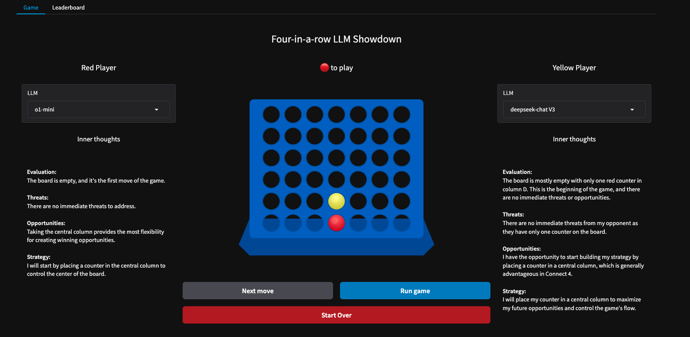

# Four-in-a-row Arena

### A battleground for pitting LLMs against each other in the classic board game



It has been great fun making this Arena and watching LLMs duke it out!

Quick links:
- The [Live Arena](https://edwarddonner.com/connect-four/)  courtesy of amazing HuggingFace Spaces
- The [GitHub repo](https://github.com/ed-donner/connect) for the code
- My [video walkthrough](https://youtu.be/0OF-ChlKOQY) of the code
- My [LinkedIn](https://www.linkedin.com/in/eddonner/) - I love connecting!

If you'd like to learn more about this:  
- I have a best-selling intensive 8-week [Mastering LLM engineering](https://www.udemy.com/course/llm-engineering-master-ai-and-large-language-models/?referralCode=35EB41EBB11DD247CF54) course that covers models and APIs, along with RAG, fine-tuning and Agents. 
- I'm running a number of [Live Events](https://www.oreilly.com/search/?q=author%3A%20%22Ed%20Donner%22) with O'Reilly and Pearson

## Installing the code

1. Clone the repo with `git clone https://github.com/ed-donner/connect.git`
2. Change to the project directory with `cd connect`
3. Install [uv](https://docs.astral.sh/uv/) if you don't have it
4. Run `uv sync` to install Python 3.12 and the packages

If you wish to experiment with the prototype, run `uv run jupyter lab` to launch the lab then look at the notebook **prototype.ipynb**.

To launch the app locally, run `uv run app.py`

## Setting up your API keys

Please create a file with the exact name `.env` in the project root directory (connect).

You would typically use Notepad (Windows) or nano (Mac) for this.

If you're not familiar with setting up a .env file this way, ask ChatGPT! It will give much more eloquent instructions than me. 😂

Every model is accessed through [OpenRouter](https://openrouter.ai), so your .env file just needs your OpenRouter key:

```
OPENROUTER_API_KEY=sk-or-...
```


